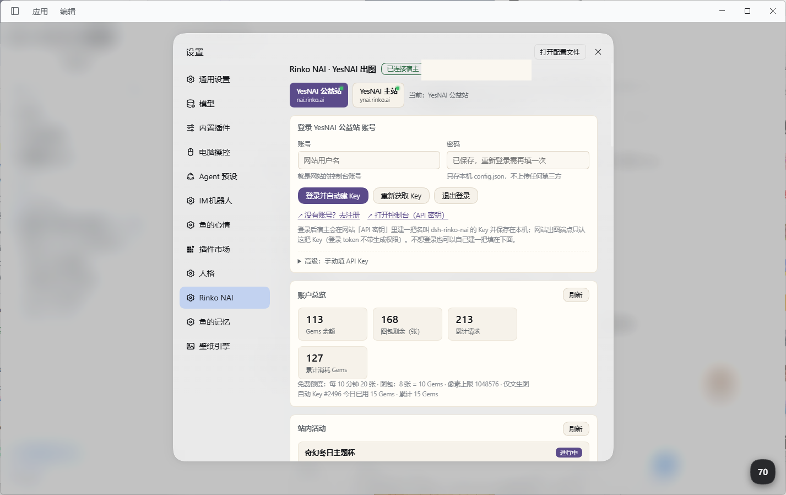
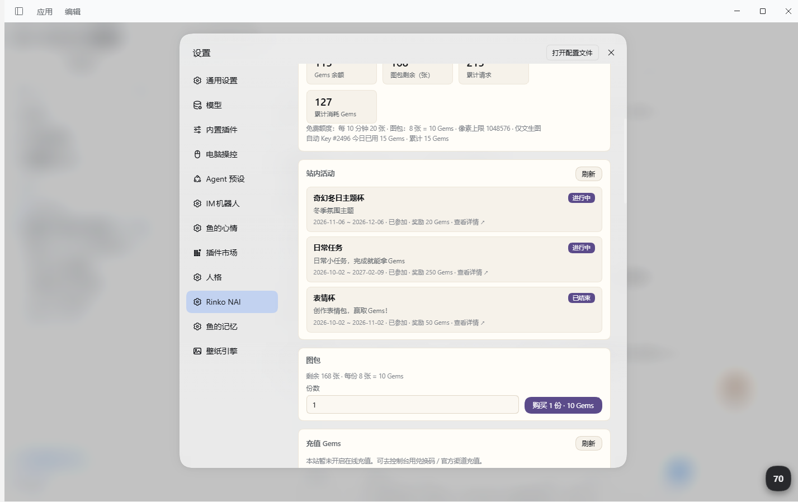
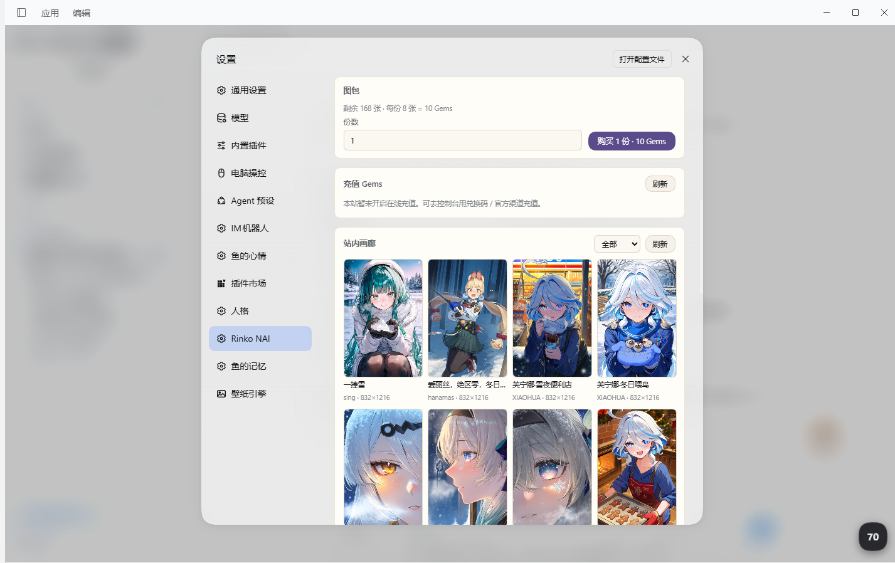
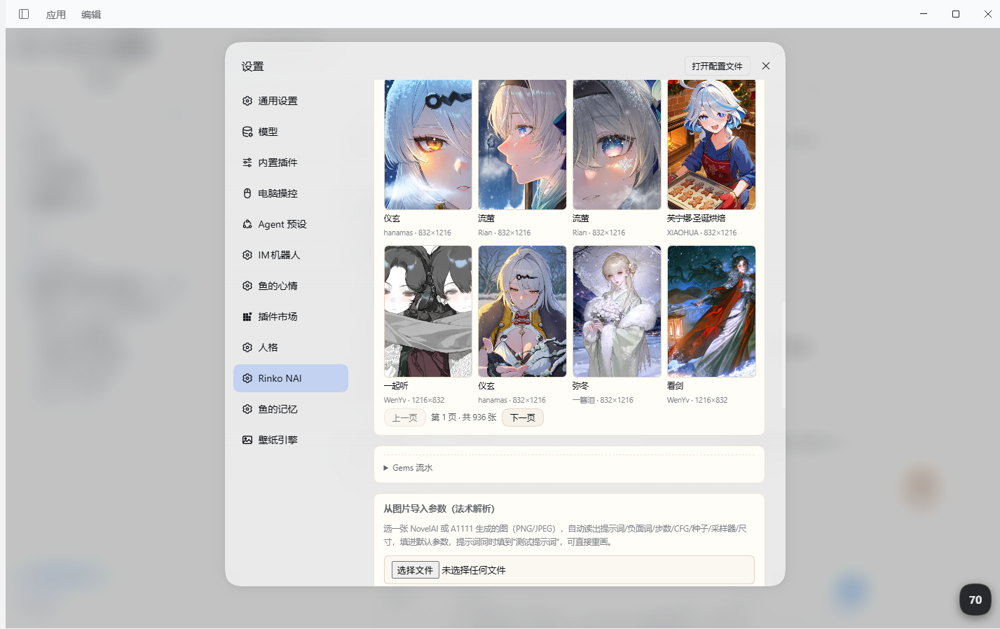

# dsh-rinko-nai

DSH 插件：在 DSH 里直接用 **YesNAI（公益站 nai.rinko.ai / 主站 ynai.rinko.ai）** 出图 —— 对话里一句话让模型调用
`rinko_nai_image` 工具，图落到本地，设置页还带登录、参数和测试面板。

> **下载**：到 [Releases](https://github.com/holosama212/dsh-rinko-nai/releases) 下载最新 `dsh-rinko-nai-v*.zip`，解压即用（或点 Code → Download ZIP 拿源码）。

## 截图

| | |
|---|---|
|  |  |
|  |  |

## 一键安装（把仓库地址丢给你的 AI）

最省事：把下面这句话（连同仓库地址）发给你正在用的 AI，它能读写文件、跑命令，会帮你装好：

> 帮我把这个 DSH 插件装进本机：`https://github.com/holosama212/dsh-rinko-nai`
> ——解压/放到 `<DSH_HOME>\plugins\dsh-rinko-nai`；在 `<DSH_HOME>\profiles\web\package.json` 的 `dependencies` 加 `"dsh-rinko-nai": "link:../../plugins/dsh-rinko-nai"`、`dsh.profile.bundles` 加 `"dsh-rinko-nai"`；在 `node_modules` 建 Junction 指向插件目录；最后提示我重启 DSH。

## 它做什么

- **双站支持**：公益站 `nai.rinko.ai` 与主站 `ynai.rinko.ai`（同一套接口，账号与 Gems 各自独立）。
  设置页顶部有两个站点标签，点一下切换；每个站点各自保存账号、Key、余额与画廊，互不干扰。
- **`rinko_nai_image`**：出图（1–4 张/次）或询价（`quote:true`，**0 Gems，但仍需有效 Key**）。走「当前激活站点」。图片存
  `<DSH_HOME>/media/rinko-nai/`，返回绝对路径，直接交给 `present` / `dsh_im_return_file` 发出去。
- **`rinko_nai_status`**：通道体检 —— 模型列表、Key 有效性、Gems 余额、图包张数、
  自动 Key 的今日用量、最近一次生成记录。出图报错先跑它。
- **设置页「Rinko NAI」**：
  - 登录卡（账号密码登录 / 自动建 Key / 重新获取 Key / 退出登录）
  - **账户总览**：Gems 余额、图包剩余张数、免费额度规则（每 10 分钟 N 张）、累计请求与累计消耗、自动 Key 的今日用量
  - **站内画廊**：全站公开作品网格（缩略图走宿主代理，不暴露 token）、按 rating 筛选（全部/全年龄/擦边/R18）、翻页、点开看大图
  - **Gems 流水**：出图扣费 / 退款 / 买图包逐条记录与余额
  - **站内活动**：公益活动列表，点卡片在浏览器打开详情页
  - **图包购买** / **充值**：按站点开关自适应（买图包扣 Gems、充值走浏览器支付页）
  - 默认参数（模型 / 尺寸 / 步数 / CFG / 采样器 / 噪声调度 / 负面词 / 附加串）
  - 测试连接、测试出图（带缩略图）
- **对话页悬浮球**：右下角一个小头像球，点一下弹出插件设置面板，不用去设置页找。

## 怎么用（三步）

1. 装好插件，重启 DSH。
2. 打开 **设置 → Rinko NAI**，输入 YesNAI 的**账号密码**，点「登录并自动建 Key」。
   - 插件会登录网站、在控制台「API 密钥」里自动创建一把名叫 `dsh-rinko-nai` 的 Key 并存到本机。
   - 没有账号就去 nai.rinko.ai 注册一个。
3. 对话里直接说「画一张 1girl, silver hair, fox ears …」即可。

不想登录的也可以自己在网站控制台建一把 `ynai-` Key，粘进设置页「高级：手动填 API Key」。

## 凭据与安全

- 出图端点只认 `ynai-` API Key（登录 token 无生成权限），所以「登录」本质是帮你把 Key 自动建好。
- Key / 密码**明文存在本机** `<DSH_HOME>/rinko-nai/config.json`，不经过任何第三方；
  设置页只回显掩码（`ynai-xwPVs…tclk`），重新登录才需要再输一次密码。
- 自动 Key 失效（被停用/删除）时，下次出图会自动重新登录并取/建新 Key；「重新获取 Key」按钮可手动触发。
- 「退出登录」只清本机凭据；要彻底停用 Key 请去网站控制台。
- **发布时不要把 `<DSH_HOME>/rinko-nai/config.json` 打进包里**：那是使用者自己的凭据文件，
  插件代码本身不含任何账号密码。

## 默认参数

默认 `nai-diffusion-4-5-full` · 832×1216 · 28 步 · CFG 5 · `k_euler_ancestral` · karras，
全部可在设置页改。「默认附加串」会自动拼在每次 prompt 末尾（放画师串 / 质量串）。

## 可用模型（16 个）

`nai-diffusion-5-full` / `-5-curated` / `-4-5-full` / `-4-5-curated` / `-4-full` / `-4-curated` /
`-3` / `-3-furry` / `-3-inpainting` / `-4-5-full-inpainting` / `-4-5-curated-inpainting` /
`-4-full-inpainting` / `-4-curated-inpainting` / `-5-full-inpainting` / `-5-curated-inpainting`
（inpainting 系列暂未接入底图流程，预留）

## 计费

免费档位（如 4-5-full 832×1216 ≤ 28 步）报价 **0 Gems（但仍需有效 Key，无 Key 会 401）**；超出免费档按 Gems 计费，
出图前可传 `quote:true` 询价。错误码对照：`INVALID_API_TOKEN`（Key 失效）、
`MODEL_NOT_ALLOWED`（Key 模型白名单）、`API_TOKEN_DAILY_GEMS_LIMIT_EXCEEDED`（Key 日限）、
`TOKEN_FREE_ONLY`（Key 只许免费）、`INSUFFICIENT_GEMS`（余额不足）。

## 安装

1. 把本目录放到 `<DSH_HOME>/plugins/dsh-rinko-nai`。
2. `<DSH_HOME>/profiles/web/package.json`：
   - `dependencies` 加 `"dsh-rinko-nai": "link:../../plugins/dsh-rinko-nai"`
   - `dsh.profile.bundles` 加 `"dsh-rinko-nai"`
3. `node_modules/dsh-rinko-nai` 建 Junction 指向插件目录（或跑一次 pnpm install）。
4. 重启 DSH。

## 更新日志（历史）

1. **`params_version: 3` 删掉了** —— 网站出图端点收到这个字段会直接崩，回 Cloudflare 502
   （请求体 `error code: 502`，17s 左右后才回，失败自动退款）。这是「一直 500」的主因；
   同一把 Key、同一套其余参数，去掉这一个字段立刻 200 出图。
2. **成功判定放宽** —— 出图成功时网站回的 `job.status` 是 `"charged"`，不是 `"succeeded"`。
   原版死等 `"succeeded"`，于是 HTTP 200 也被判失败。现在有图片数据就算成功。
3. **count>1 改成循环单张** —— 免费档 `n_samples>1` 会被限流（429），改成 N 次单张请求。
4. 429 增加可读提示（限流/Key 今日额度用尽）。

## 排障

- 先跑 `rinko_nai_status`：`modelsOk` 看连通、`keyValid` 看凭据、`account` 看账户。
- **报错 `SyntaxError: Unexpected token ''` / 插件被跳过、加载不了**：`package.json` 开头混进了 **UTF-8 BOM**（旧包问题，≥1.0.1 已修）。手动救：把文件另存为「UTF-8 无 BOM」；或运行
  `node -e "const fs=require('fs'),f='package.json',b=fs.readFileSync(f);if(b[0]===0xEF&&b[1]===0xBB&&b[2]===0xBF)fs.writeFileSync(f,b.subarray(3))"`。
- **网络慢/连不上 → 建议开代理**：插件走系统网络（不读插件内代理设置）。若出图或查账户经常「连接超时 / 连不上站点」，多半是到 `*.rinko.ai` 的直连不稳，**开启代理（如 Clash，建议“全局”或“TUN”模式）后再试**即可。插件每次请求分两段计时：**连接 20 秒**连不上就快速报错（不会干吊几百秒），连上后最多等 **180 秒**出图。
- HTTP 502/504：网站上游抖了，稍后再试（设置页「测试连接」会如实报告）。
  实测 2026-11-20 晚：直连与 Clash 代理（127.0.0.1:7897）**同样 502**，且失败请求会自动退款
  （`wallet/ledger` 里是 `generation_debit` + `generation_refund` 成对出现），说明是站点自己的出图上游故障，与本地网络无关。
- `请求失败 / fetch failed`：本机到 `*.rinko.ai` 的网络问题——**先试开代理**，再查防火墙。
- 日志：宿主控制台里 `[rinko-nai]` 前缀。

## 用到的端点（宿主转发）

| 用途 | 端点 |
|---|---|
| 登录 | `POST /api/ynai/auth/login` |
| 账户 | `GET /api/ynai/user/self`、`GET /api/ynai/user/balance` |
| 图包额度 | `GET /api/ynai/image-packs` |
| Key 管理 | `GET/POST /api/ynai/tokens`、`POST /api/ynai/tokens/{id}/key`、`DELETE /api/ynai/tokens/{id}` |
| 画廊 | `GET /api/ynai/gallery/artworks?limit&offset&rating`、`GET /api/ynai/gallery/media/{id}/thumbnail` |
| 流水 | `GET /api/ynai/wallet/ledger?limit` |
| 出图 | `POST /v1/nai/generate-image`、`POST /ai/generate-image/quote`、`GET /v1/models` |

插件自己的同源路由：`/api/rinko-nai/{state,config,login,logout,rekey,account,gallery,ledger,thumb,media,test,generate,file}`。
